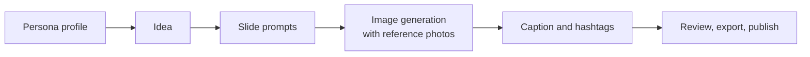

<p align="center">
  
</p>

<h1 align="center">PersonaAI</h1>

<p align="center">
  An open-source platform that generates Instagram carousels and short videos for AI personas,
  from the first idea to a ready-to-post caption.
</p>

<p align="center">
  
  
  
  
</p>

> Built at the **GenAI Lab, Technical University of Munich (TUM)** as a practical artifact of
> research on AI-driven content creation. The repository is named `influenceos`; the project is
> called PersonaAI.

## What it does

Running a social media persona means doing the same creative work again and again: finding an
idea, planning a visual story, producing consistent images, writing the caption. PersonaAI turns
that into a pipeline you set up once per persona and then run whenever you need a new post.

- **Persona manager** – every AI influencer has a personality, visual style, tone of voice,
  target audience, things to avoid and reference photos. This profile steers every generation.
- **Carousel pipeline** – idea → slide-by-slide image prompts → images → caption and hashtags.
  Images are generated from the persona's reference photos so the same face and style carry
  across all slides.
- **Video pipeline** – generate a first and a last frame, then turn them into a short clip with
  Veo 3.1.
- **Visual workflow builder** – chain *Trigger*, *LLM* and *Image generation* nodes on a canvas
  (React Flow) and run the graph. Nodes reference each other's output with `{{node.field}}`.
- **Everything is editable** – the prompts behind each step are exposed in the UI, so you can
  inspect, edit and reset them.
- **Review and publish** – browse past generations, mark posts as published, export to Google
  Drive, and track Instagram performance in an analytics dashboard.

## How a carousel is made



1. **Idea** – Gemini proposes a topic that fits the persona's niche and audience, or you provide
   your own list of topics.
2. **Slide prompts** – the topic is split into slides, each with a headline, supporting text and a
   detailed image prompt. A shared set of visual rules keeps palette, lighting and composition
   consistent.
3. **Images** – each slide is rendered with a Nano Banana model. You choose the model (fast,
   balanced or pro) and the aspect ratio, and you can regenerate single slides.
4. **Caption** – a caption and a configurable number of hashtags are written in the persona's
   voice.

## Architecture

```
┌──────────────────────────── Browser (React + Vite) ────────────────────────────┐
│  Pages: Influencers · Carousel · Video · Workflow builder · Analytics · Settings │
│  Services: generator · executor · veo · rate limiter · drive · instagram         │
└───────────────┬───────────────────────────────┬────────────────────────────────┘
                │                               │
        Supabase (your project)          External APIs (your keys)
        · Google sign-in                 · Gemini: text, images
        · Postgres + row-level security  · Veo 3.1: video
        · image storage                  · Google Drive: export
                                         · Instagram: publishing and metrics
```

- **No custom backend.** The app is a static front end; data lives in your own Supabase project.
- **Row-level security** on every table, so each user only ever sees their own data.
- **API keys stay yours.** They are entered in *Settings* and stored in your Supabase, never
  shared.
- **Rate limiting built in.** A sliding-window limiter, with separate budgets for text and image
  calls, keeps requests inside Gemini's quotas (preview image models have a much lower limit
  than text models).
- **Workflow executor.** Graphs are run in topological order; each node's status (running,
  done, error) streams back to the canvas.

## Tech stack

| Layer | Tools |
| --- | --- |
| Front end | React 18, Vite, React Flow (`@xyflow/react`) |
| Data and auth | Supabase (Postgres, row-level security, storage, Google sign-in) |
| Generation | Gemini API (text), Nano Banana models (images), Veo 3.1 (video) |
| Integrations | Google Drive API, Instagram Graph API, RapidAPI (Instagram analytics) |
| Hosting | Vercel |

## Getting started

### 1. Supabase

1. Create a project at [supabase.com](https://supabase.com) (the free tier is enough).
2. In the SQL Editor, run [`supabase/schema.sql`](supabase/schema.sql). It creates all tables and
   security policies.
3. Under **Authentication → Providers**, enable **Google**.
4. Copy the **Project URL** and the **anon public key** from *Project Settings → API*.

### 2. Google OAuth client

1. In [Google Cloud Console](https://console.cloud.google.com), create a project and enable the
   **Google Drive API** and **Google Identity Services**.
2. Create an **OAuth 2.0 Client ID** (Web application).
3. Add your local or deployed URL to *Authorized JavaScript origins*, and to the redirect URIs
   in your Supabase auth settings.

### 3. Environment

```bash
cp .env.example .env
```

```
VITE_SUPABASE_URL=https://your-project.supabase.co
VITE_SUPABASE_ANON_KEY=your-anon-key
VITE_GOOGLE_CLIENT_ID=your-google-oauth-client-id
```

### 4. Run

```bash
npm install
npm run dev
```

### 5. Add your API keys in the app

After signing in, open **Settings** and add:

- **Gemini API key** from [aistudio.google.com](https://aistudio.google.com) (free tier available)
- **RapidAPI key** for *Instagram Looter 2*, only needed for analytics (free tier available)

## Project structure

```
src/
├── pages/          Influencers, carousel and video pipelines, workflow builder,
│                   analytics, Instagram, settings
├── components/     Sidebar, persona modal, workflow canvas (nodes, config panel)
├── services/       generator (prompts and Gemini calls), executor (workflow runner),
│                   veo, rateLimiter, drive, instagram, instagramGraph
├── store.js        Supabase-backed data access
└── supabase.js     client setup
supabase/
└── schema.sql      tables and row-level security policies
```

## Notes

- Generated content is for the personas you define. Check the terms of every platform you
  publish to before automating posts.
- Image and video models are in preview and their quotas change; adjust the limits in
  `src/services/rateLimiter.js` if you hit 429 errors.
